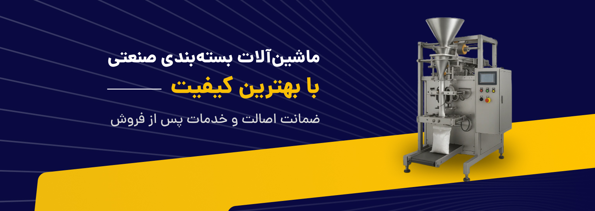
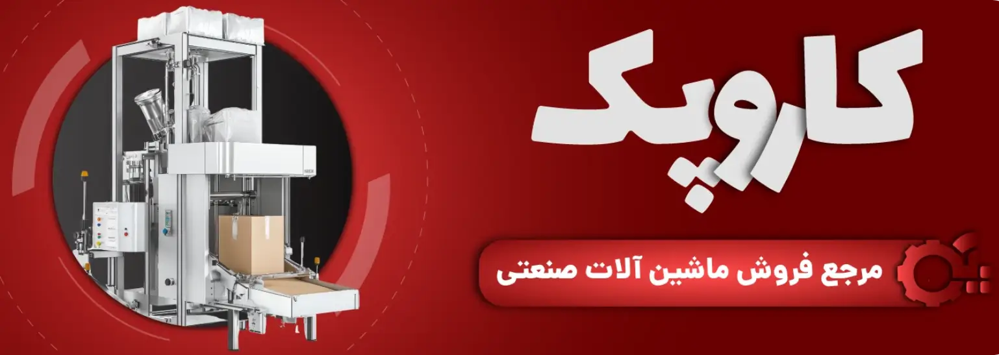
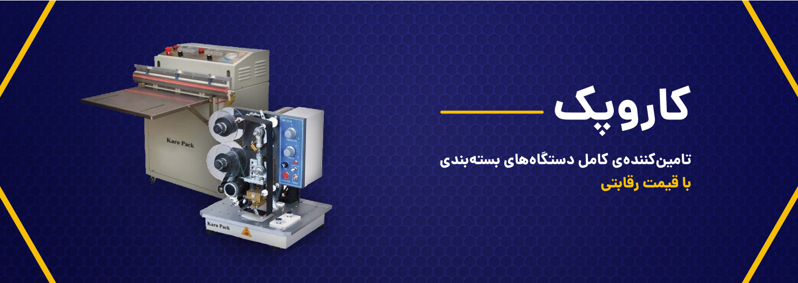

# تامین کننده ماشین آلات صنعتی و بسته بندی

## کاروپک؛ تامین‌کننده ماشین‌آلات صنعتی و بسته‌بندی

### دسته بندی های کاروپک

#### [سیل وکیوم](dsth-bndy-mhswlat/khryd-dstgah-syl-wkywm-or-qymt-anwaa-mdl-ha-+-mshawrh-raygan.md)

>)

[نمایش بیشتر](dsth-bndy-mhswlat/khryd-dstgah-syl-wkywm-or-qymt-anwaa-mdl-ha-+-mshawrh-raygan.md)

#### [دستگاه تاریخ زن](dsth-bndy-mhswlat/qymt-dstgah-tarykh-zn-or-khryd-anwaa-tarykh-zn-dsty-hrarty-w-rwmyzy.md)

>)

[نمایش بیشتر](dsth-bndy-mhswlat/qymt-dstgah-tarykh-zn-or-khryd-anwaa-tarykh-zn-dsty-hrarty-w-rwmyzy.md)

#### [دستگاه دوخت ریلی](dstgah-dwkht-ryly-or-qymt-+-khryd-anwaa-dwkht-ryly-rwmyzy-w-aystadh.md)

>)

[نمایش بیشتر](dstgah-dwkht-ryly-or-qymt-+-khryd-anwaa-dwkht-ryly-rwmyzy-w-aystadh.md)

#### [دستگاه تسمه کش](dsth-bndy-mhswlat/dstgah-tsmh-ksh-qymt-1404-+-atwmatyk-w-dst-dwm.md)

>)

[نمایش بیشتر](dsth-bndy-mhswlat/dstgah-tsmh-ksh-qymt-1404-+-atwmatyk-w-dst-dwm.md)

#### [دستگاه چسب زن کارتن](chsb-zn-kartn-snaty-khryd-nw-w-dst-dwm-1405.md)

>)

[نمایش بیشتر](chsb-zn-kartn-snaty-khryd-nw-w-dst-dwm-1405.md)

#### [دستگاه وکیوم بسته بندی](dsth-bndy-mhswlat/khryd-dstgah-wkywm-bsth-bndy-or-khangy-or-mwad-ghthayy-or-qymt.md)

>)

[نمایش بیشتر](dsth-bndy-mhswlat/khryd-dstgah-wkywm-bsth-bndy-or-khangy-or-mwad-ghthayy-or-qymt.md)

#### [دستگاه پرده هوا](dsth-bndy-mhswlat/prdh-hwa-snaty-gac-900-qymt-1404+-dst-dwm.md)

>)

[نمایش بیشتر](dsth-bndy-mhswlat/prdh-hwa-snaty-gac-900-qymt-1404+-dst-dwm.md)

#### [دستگاه سیل القایی](dsth-bndy-mhswlat/qymt-w-khryd-anwaa-dstgah-plmp-syl-alqayy-drb-btry.md)

>)

[نمایش بیشتر](dsth-bndy-mhswlat/qymt-w-khryd-anwaa-dstgah-plmp-syl-alqayy-drb-btry.md)

#### [دستگاه پرکن](dsth-bndy-mhswlat/qymt-dstgah-prkn-or-khryd-anwaa-prkn-mayaat-w-jamdat.md)

>)

[نمایش بیشتر](dsth-bndy-mhswlat/qymt-dstgah-prkn-or-khryd-anwaa-prkn-mayaat-w-jamdat.md)

#### [دستگاه دوخت نایلون و پلاستیک](dsth-bndy-mhswlat/qymt-w-khryd-dstgah-dwkht-naylwn-w-plastyk-snaty-w-dsty.md)

>)

[نمایش بیشتر](dsth-bndy-mhswlat/qymt-w-khryd-dstgah-dwkht-naylwn-w-plastyk-snaty-w-dsty.md)

#### [دستگاه شیرینگ پک](khryd-anwaa-dstgah-shyryng-pk-karwpk-nw-w-dst-dwm-arzan.md)

>)

[نمایش بیشتر](khryd-anwaa-dstgah-shyryng-pk-karwpk-nw-w-dst-dwm-arzan.md)

#### [دستگاه جت پرینتر](dsth-bndy-mhswlat/jt-pryntr-hay-snaty-w-dsty-industrial-inkjet-printer-+-khryd-+-qymt.md)

>)

[نمایش بیشتر](dsth-bndy-mhswlat/jt-pryntr-hay-snaty-w-dsty-industrial-inkjet-printer-+-khryd-+-qymt.md)

### برخی از مشتریان ما

>)

>)

>)

>)

>)

>)

>)

>)

>)

>)

>)

>)

>)

>)

### برخی از محصولات ما

#### [دستگاه بسته بندی حبوبات خانگی با ارزانترین قیمت](frwsh-anwaa-dstgah-bsth-bndy-hbwbat-khangy-ba-arzantryn-qymt.md)

>)

فروش انواع دستگاه بسته بندی حبوبات خانگی با بالاترین میزان کیفیت و ارزانترین قیمت | خرید دستگاه های بسته بندی حبوبات خانگی با ضمانت نامه معتبر، خدمات پس از فروش طولانی مدت و مشاوره رایگان

#### [دستگاه سیل رومیزی مدل KP-2050](khryd-syl-rwmyzy-kp-2050-nw-w-dst-dwm-1405.md)

>)

قیمت دستگاه سیل رومیزی KP-2050 کاروپک (نیمه اتوماتیک، بدنه استیل) نو و دست دوم ارزان | مناسب رستوران و کارگاه کوچک، گارانتی، اقساطی ✅ ۰۲۱۲۶۲۱۴۰۹۴ - ۰۹۱۳۱۰۷۲۹۲۵

#### [دستگاه وکیوم تک کابین با تزریق گاز GDZ-500](khryd-dstgah-wkywm-tk-kabyn-ba-tzryq-gaz-ba-bhtryn-qymt.md)

>)

دستگاه وکیوم تک کابین برای وکیوم کردن تمامی محصولات در سایز های متناسب با کابین دستگاه استفاده می شود. شما می توانید قیمت دستگاه وکیوم بسته بندی را از کاروپک استعلام کنید و در نهایت خرید دستگاه وکیوم تک کابین را انجام دهید.

#### [دستگاه پرکن حجمی نیمه اتوماتیک](qymt-w-khryd-dstgah-prkn-hjmy-nymh-atwmatyk.md)

>)

دستگاه پرکن حجمی نیمه اتوماتیک جهت پر کردن ظروف از مواد گرانولی به صورت حجمی (پیمانه ای) مورد استفاده قرار می گیرد.سیستم دستگاه مکانیکی است

#### [دستگاه بسته بندی ساشه دانه ای](qymt-w-khryd-dstgah-bsth-bndy-sashh-y-danh-ay.md)

>)

دستگاه بسته بندی ساشه ی دانه ای مواد گرانولی ریز به فرم ساشه مورد استفاده قرار می گیرد که بنا به سفارش بصورت ساشه ی سه طرف دوخت یا ساشه ی مدادی ارائه می گردد...

#### [دستگاه پرکن پودری](dstgah-prkn-pwdry-+-qymt-khryd-mrja-frwsh-dstgah-hay-bsth-bndy-dr-ayran.md)

>)

دستگاه پرکن پودری جهت پر کردن انواع پت، قوطی و یا کیسه از مواد پودری مورد استفاده قرار می گیرد.این دستگاه بنا به سفارش، قابل ارائه بصورت اتوماتیک یا نیمه اتوماتیک می باشد.

#### [دستگاه دوخت و برش دستی GMF-500](frwsh-dstgah-dwkht-plastyk-dsty-ba-brsh-or-mdl-nw-w-dst-dwm-ba-mshawrh-raygan.md)

>)

دستگاه دوخت و برش دستی مدل GMF-500، برای مشاوره رایگان خرید انواع دستگاه دوخت دست دوم و نو می‌توانید با کاروپک تماس بگیرید، کلیه ی محصولات تست شده همراه با ضمانت به فروش میرسد.

#### [دستگاه بسته بندی دو توزین مدل GFA-100](dstgah-bsth-bndy-dw-twzyn-or-qymt-w-khryd-dstgah-dw-twzyny.md)

>)

خرید اینترنتی دستگاه بسته بندی دو توزین با کمترین و ارزانترین قیمت | فروش دستگاه دو توزینی با ضمانت نامه معتبر، گواهی اصالت کالا و خدمات پس از فروش قوی به همران تخفبقات ویژه | ارسال به تمامی نقاط کشور در کوتاه ترین زمان

#### [دستگاه دوخت پنوماتیک GNF-600](qymt-dstgah-dwkht-pnwmatyk-nw-w-dst-dwm-1404.md)

>)

خرید دستگاه دوخت پنوماتیک نو و دست دوم از کاروپک با بهترین قیمت ۱۴۰۴، گارانتی ۱ ساله، اقساطی، تحویل فوری و خدمات ۵ ساله ✅ ۰۹۱۳۱۰۷۲۹۲۵ و ۰۲۱۲۶۲۱۴۰۹۴

#### [دستگاه بسته بندی چهار توزین](qymt-w-khryd-dstgah-bsth-bndy-danh-ay-4-twzyn.md)

>)

دستگاه بسته بندی دانه ای 4 توزین، جهت بسته بندی انواع زیادی از محصولات به ویژه محصولات گرانولی در بسته های به فرم بالشتی مورد استفاده قرار می گیرد که با نصب سیستم پاکت کن ...

#### [دستگاه بسته بندی دانه ای حجمی](dstgah-bsth-bndy-hjmy-pymanh-ay-danh-ay-+-qymt-khryd.md)

>)

دستگاه بسته بندی دانه ای حجمی، جهت بسته بندی محصولات گرانولی با شکل هندسی منظم و مشابه در بسته های سایز معمولی و به فرم بالشتی مورد استفاده قرار می گیرد که...

#### [دستگاه وکیوم رومیزی دستی مدل GDZ-300](qymt-w-khryd-dstgah-wkywm-rwmyzy-dsty-mdl-gdz-300.md)

>)

دستگاه وکیوم رومیزی دستی GDZ-300 ، جهت تخلیه ی هوای داخل کیسه های موادغذایی به منظور بالا بردن ماندگاری، مورد استفاده قرار می گیرد. برای مشاوره رایگان خرید و یا استعلام قیمت دستگاه وکیوم رومیزی دستی کلیک نمایید.

>)

### درباره کاروپک بیشتر بدانید

مرجع فروش ماشین آلات صنعتی

کاروپک بزرگترین شرکت ماشین آلات و دستگاه های صنعتی در ایران که با برخورداری از بهترین و باکیفت ترین انواع دستگاه های بسته بندی و ارائه تمامی انواع با بهترین قیمتگذاری، توانسته است رضایت تمامی مشتریان خود را جلب نماید. تمامی ماشین آلات صنعتی موجود در کاروپک دارای ضمانت نامه معتبر، گواهی اصالت کالا و خدمات پس از فروش طولانی مدت می باشند.

برای کسب اطلاعات کامل و مشاوره رایگان در خصوص کسب و کار خود می توانید با متخصصات کاروپک در ارتباط باشید.

[مشاوره رایگان](tmas-ba-ma.md)

### اخبار و مقالات

آخرین اخبار و مقالات کاروپک را دنبال کنید

#### [دستگاه تاریخ زن چیست؟ معرفی انواع دستگاه تاریخ زن و کاربرد هرکدام](akhbar-w-mqalat/dstgah-tarykh-zn-chyst-marfy-anwaa-dstgah-tarykh-zn-w-karbrd-hrkdam.md)

>)

دستگاه تاریخ زن چیست و چه کاربردی دارد؟ در این مقاله با انواع دستگاه تاریخ زن دستی، نیمه‌اتوماتیک و اتوماتیک، مزایا، کاربردها و تفاوت آن‌ها ارائه شده توسط شرکت کاروپک آشنا شوید

#### [بهترین دستگاه تاریخ زن برای صنایع غذایی، دارویی و نوشیدنی | بررسی تخصصی](akhbar-w-mqalat/bhtryn-dstgah-tarykh-zn-bray-snaya-ghthayy-darwyy-w-nwshydny-or-brrsy-tkhssy.md)

>)

در این مقاله از کاروپک میخواهیم به بررسی بهترین دستگاه تاریخ زن برای صنایع غذایی، دارویی و نوشیدنی بپردازیم. بررسی تخصصی انواع مدل‌ها، نوع چاپ، مزایا و انتخاب مناسب هر صنعت

#### [راهنمای خرید دستگاه سیل وکیوم + مقایسه مدل‌های کاروپک ۱۴۰۵](akhbar-w-mqalat/rahnmay-khryd-dstgah-syl-wkywm-+-mqaysh-mdl-hay-karwpk-1405.md)

>)

راهنمای کامل خرید دستگاه سیل وکیوم: مقایسه رومیزی، اتوماتیک و تزریق گاز کاروپک (GSV-50، KP-2050، GSV-45). کدام مدل برای کارگاه کوچک، رستوران یا خط تولید مناسب است؟ قیمت، مزایا و نکات کلیدی ۱۴۰۵

#### [تزریق گاز در دستگاه سیل وکیوم چیست؟ مزایا و تفاوت با وکیوم ساده](akhbar-w-mqalat/tzryq-gaz-dr-dstgah-syl-wkywm-chyst-mzaya-w-tfawt-ba-wkywm-sadh.md)

>)

تزریق گاز (MAP) در دستگاه سیل وکیوم ماندگاری گوشت، مرغ، ماهی و غذاهای آماده را ۵ تا ۱۵ برابر افزایش می‌دهد. تفاوت وکیوم ساده و با گاز چیست؟ مزایا، گازهای مناسب و مدل‌های کاروپک (GSV-50)

#### [راهنمای خرید دستگاه تاریخ زن | نکات مهم انتخاب بهترین مدل برای کسب‌وکار شما](akhbar-w-mqalat/rahnmay-khryd-dstgah-tarykh-zn-or-nkat-mhm-antkhab-bhtryn-mdl-bray-ksb-wkar-shma.md)

>)

برای خرید دستگاه تاریخ زن به چه نکاتی باید توجه کرد؟ در این راهنمای کامل، یکی دیگر از مقالات آموزشی شرکت کاروپک، انواع دستگاه تاریخ زن، قیمت، کاربردها و انتخاب بهترین مدل را بررسی میکنیم.

#### [دستگاه سیل وکیوم چیست؟ مزایا و کاربردها در بسته بندی غذایی](akhbar-w-mqalat/dstgah-syl-wkywm-chyst-mzaya-w-karbrdha-dr-bsth-bndy-ghthayy.md)

>)

دستگاه سیل وکیوم با تخلیه هوا ماندگاری مواد غذایی را ۳ تا ۱۰ برابر افزایش می‌دهد. در این راهنما با انواع، مزایا و کاربردهای سیل وکیوم آشنا شوید. شرکت کاروپک بهترین مدل‌ها را با قیمت مناسب عرضه می‌کند.

### شرکت کاروپک

[**شرکت کاروپک**](https://karopack.ir/) در زمینه تولید و ارائه ماشین آلات بسته بندی فعالیت دارد و تجهیزات متنوعی برای نیاز صنایع و کسب و کارهای مختلف طراحی می کند. از محصولات این مجموعه می توان به دستگاه سیل وکیوم، دستگاه تاریخ زن، **دستگاه دوخت ریلی**، **دستگاه تسمه کش** و دستگاه بسته بندی حبوبات خانگی اشاره کرد. **دستگاه سیل وکیوم** برای بسته بندی و ایجاد وکیوم در ظروف کاربرد دارد و [**دستگاه تاریخ زن**](dsth-bndy-mhswlat/qymt-dstgah-tarykh-zn-or-khryd-anwaa-tarykh-zn-dsty-hrarty-w-rwmyzy.md) برای درج تاریخ تولید و انقضا استفاده می شود. دستگاه دوخت ریلی برای بسته بندی سریع، **دستگاه تسمه کش** برای محکم کردن بسته ها و [**دستگاه بسته بندی حبوبات خانگی**](frwsh-anwaa-dstgah-bsth-bndy-hbwbat-khangy-ba-arzantryn-qymt.md) برای بسته بندی حبوبات در مقیاس کوچک مورد استفاده قرار می گیرند. تولید این دستگاه ها با توجه به نیاز مشتری انجام می شود.

تجهیزات تولید شده توسط **شرکت کاروپک** می توانند برای بسته بندی محصولات مختلف در صنایع غذایی، دارویی، بهداشتی و تولیدی مورد استفاده قرار گیرند. انتخاب هر دستگاه بسته به نوع محصول، حجم تولید و نوع بسته بندی انجام می شود. [**دستگاه سیل وکیوم**](dsth-bndy-mhswlat/khryd-dstgah-syl-wkywm-or-qymt-anwaa-mdl-ha-+-mshawrh-raygan.md) برای بسته بندی حرفه ای محصولات، **دستگاه تاریخ زن** برای درج اطلاعات روی بسته ها و [**دستگاه دوخت ریلی**](dstgah-dwkht-ryly-or-qymt-+-khryd-anwaa-dwkht-ryly-rwmyzy-w-aystadh.md) برای دوخت سریع و مداوم کیسه ها کاربرد دارد. همچنین [**دستگاه تسمه کش**](dsth-bndy-mhswlat/dstgah-tsmh-ksh-qymt-1404-+-atwmatyk-w-dst-dwm.md) برای افزایش استحکام بسته ها در زمان حمل و نقل استفاده می شود. **دستگاه بسته بندی حبوبات خانگی** نیز برای مشاغل کوچک و تولیدکنندگان خانگی گزینه ای کاربردی محسوب می شود. **کاروپک** با تولید این تجهیزات، راهکارهای متنوعی برای بسته بندی ارائه می دهد.
